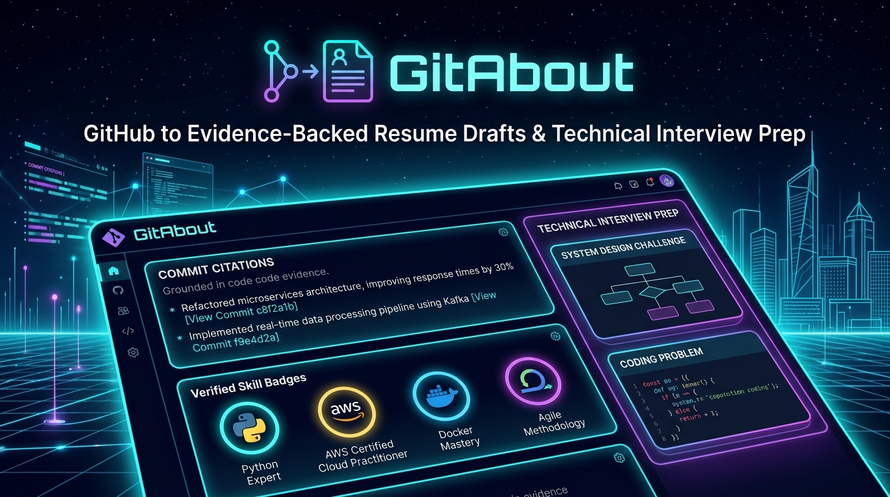

<p align="center">
  
</p>

<h1 align="center">GitAbout</h1>

<p align="center">
  <strong>Transform public GitHub repositories into evidence-grounded resume drafts and technical interview prep. Zero hallucination. Every claim cited.</strong>
</p>

<p align="center">
  <a href="#-key-features">Features</a> •
  <a href="#-architecture">Architecture</a> •
  <a href="#-quickstart">Quickstart</a> •
  <a href="#-non-negotiable-product-rules">Rules</a> •
  <a href="#-roadmap">Roadmap</a>
</p>

---

## 💡 Core Philosophy

> **This is a DRAFT and PREP tool, not an auto-generated final resume.**
> 
> GitAbout analyzes public codebases to discover an engineer's strongest work, extract verified dependencies, and draft high-impact bullet points citing exact files, manifests, and git commits. The candidate edits and owns every claim.

---

## 🌟 Key Features

- **🛡️ Zero-Hallucination Policy:** The LLM is strictly constrained to facts in the repo context. Metrics, user counts, and benchmark numbers are never fabricated.
- **🔗 Mandatory Evidence Citations:** Every bullet point and talking point cites its concrete source (e.g. `README.md`, `package.json: @upstash/redis`, or `commit: "fix: line-level section segmentation"`). Uncited drafts are automatically rejected and dropped.
- **❓ Ask, Don't Guess:** When impact metrics (latency, RPS, user counts) are missing from the code, GitAbout generates focused interview prompts for the candidate to fill in their real numbers.
- **⚖️ Deterministic Heuristic Ranking:** Repositories are ranked without LLM bias by penalizing forks (-40 pts), rewarding recent activity (+25 pts), commit density, star validation, and meaningful codebase size.
- **⚡ Token-Budgeted Context:** Each repository is condensed into a compact JSON payload under ~2,500 tokens before drafting.
- **🔄 Double-Layer Schema Guard:** Combines Google Gemini's structured JSON output mode with strict runtime **Zod** schema validation and a 1x corrective retry mechanism.
- **⏱️ Per-IP Rate Limiting & Multi-Tier Caching:** Redis caching via Upstash (with graceful in-memory Map fallback for local dev) keyed on `username + repoName + pushed_at`.
- **📋 Export Options:** Instant "Copy as Markdown" and downloadable `.md` drafts ready for Notion, Google Docs, or resumes.

---

## 🏛️ Architecture

```
GitHub Username / URL Swap (ourdomain.com/:username)
         │
         ▼
[ Octokit GitHub API ] ──► Fetch Profile, Repos, README, Manifests, Sampled Tree, Commits
         │
         ▼
[ Deterministic Ranking Heuristic ] ──► Score & select top 5 repositories (no LLM bias)
         │
         ▼
[ Context Condenser ] ──► Build compact JSON object (< 3,000 tokens)
         │
         ▼
[ Google Gemini Flash ] ──► Generate candidate bullets, verified skills & missing metrics
         │
         ▼
[ Zod Validation & Guardrail ] ──► Reject uncited claims ──► 1x Corrective Retry ──► Drop invalid
         │
         ▼
[ Multi-Tier Cache (Redis/Memory) ] ──► Keyed on username:repo:pushed_at
         │
         ▼
[ Interactive UI & Markdown Export ]
```

---

## 🛠️ Tech Stack

- **Framework:** Next.js 15+ (App Router), React 19, TypeScript (strict mode)
- **Styling:** Tailwind CSS, Glassmorphism dark aesthetic
- **GitHub API:** Octokit (REST + GraphQL support)
- **LLM Engine:** Google Gemini via official `@google/genai` SDK (`gemini-3.5-flash`)
- **Validation:** Zod schemas
- **Caching & Rate Limiting:** Upstash Redis (`@upstash/redis`, `@upstash/ratelimit`) with in-memory local fallback
- **Testing:** Vitest

---

## 🚀 Quickstart

### 1. Clone & Install Dependencies

```bash
git clone https://github.com/Insight14/GitAbout.git
cd GitAbout
npm install
```

### 2. Configure Environment Variables

Copy `.env.example` to `.env.local`:

```bash
cp .env.example .env.local
```

Populate the required credentials:

```env
# GitHub API Token (Optional for basic public queries, recommended for 5,000 req/hr quota)
GITHUB_TOKEN=your_github_token_here

# Google Gemini API Key (Required for bullet drafting)
# Obtain from: https://aistudio.google.com/
GEMINI_API_KEY=your_gemini_api_key_here

# Gemini Model Name
GEMINI_MODEL=gemini-3.5-flash

# Upstash Redis (Optional in local dev: falls back to in-memory cache)
UPSTASH_REDIS_REST_URL=
UPSTASH_REDIS_REST_TOKEN=
```

### 3. Run Development Server

```bash
npm run dev
```

Open [http://localhost:3000](http://localhost:3000) in your browser.

- Enter any GitHub username (e.g. `Insight14`, `octocat`, `torvalds`).
- Or navigate directly to `http://localhost:3000/<username>` to test the URL swap route.

### 4. Run Unit Tests

```bash
npm run test
```

---

## 🚦 Roadmap

- [x] **Phase 1: Fetch, Rank, Draft**
  - [x] GitHub metadata, sampled tree, commit logs, and manifest extraction
  - [x] Heuristic ranking engine (fork penalty, recency, size, stars)
  - [x] Gemini structured generation with Zod validation and citation enforcement
  - [x] Multi-tier caching and per-IP rate limiting
  - [x] Markdown export and interactive UI
- [ ] **Phase 2: Technical Interview Q&A Prep**
  - Architecture, tradeoffs, and system design questions
  - Flagged weak spots (no tests, missing README, unhandled errors)
  - Vercel AI SDK streaming
- [ ] **Phase 3: Job Description Tailoring**
  - Paste job description to re-rank and emphasize matching skill sets
- [ ] **Phase 4: PDF Export & OAuth**
  - PDF generation and private repo analysis via GitHub OAuth

---

## 📄 License

MIT © [Insight14](https://github.com/Insight14)
